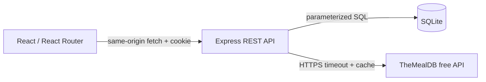

# Architecture

## Request and data flow

`client/src/pages` holds exactly six designs: landing, auth, dashboard, details, cookbook and planner. `components` shares navigation, footer, cards, image fallbacks, loading states, reveals and the native meal-planning dialog. Session context retrieves `/auth/me` on reload; Cookbook context maintains consistent saved IDs across views. React Router guards personal pages. UI requests are aborted when a view changes.

Vite proxies `/api` in development. The production Express server serves the compiled client and returns the SPA shell for client routes. This avoids permissive CORS and keeps cookies same-origin. Self-hosted font files avoid third-party font requests. Tailwind is built through its Vite plugin; custom external CSS supplies editorial styling, tokens, Grid/Flexbox, breakpoints and reduced-motion rules.

## Backend

`server/app.js` exports an injectable app factory for integration testing. It validates inputs, identifies users exclusively through authenticated sessions, checks CSRF/origins, throttles authentication and dispatches REST handlers. `server/index.js` creates the production/development listener and respects inherited HTTP proxy configuration through Undici. It does not disable TLS verification.

`server/services/recipes.js` owns TheMealDB requests, timeout handling, bounded caching and normalization. The numbered ingredient/measure fields become a clean array. Source instructions are split only at source newlines in the UI. Search and filters share the discovery page; random recipes navigate to the same details page.

## Database

`server/database/schema.sql` creates users, favorites, meal_plans and sessions. Initialization is repeatable. `node:sqlite` is available with the pinned Node 24 minimum; the database uses WAL, a busy timeout and foreign-key enforcement.

- Users: unique lowercased email, name, bcrypt hash, timestamp.
- Favorites: user foreign key, external meal ID, timestamp; unique user/meal pair.
- Meal plans: user foreign key, weekday check constraint, external meal ID, updated timestamp; unique user/day. Upsert replaces one day atomically.
- Sessions: hashed random ID, user foreign key, CSRF token, millisecond expiry. Expired records are deleted when new sessions are established.

Only IDs reference external recipes. Upstream outages therefore affect display but do not erase saved personal data. The shopping list derives separate ingredient entries from each planned recipe; it does not add incompatible units. Checklist state is intentionally ephemeral.

## Authentication and trust boundaries

Bcrypt hashes passwords with cost 12. Random 256-bit session identifiers are opaque; only their SHA-256 hashes are in SQLite. Cookies are HttpOnly, SameSite=Lax, scoped to `/`, seven days, and Secure in production. Login rotates sessions; logout deletes the corresponding record. Passwords, session IDs and CSRF tokens are never stored in localStorage.

Authenticated mutations require a session CSRF token returned by `/auth/me`, carried in `X-CSRF-Token` and checked with constant-time comparison. All mutations require JSON; cross-origin requests receive no CORS permission, incorrect Origin and cross-site Fetch Metadata are rejected. Together these protect pre-authentication requests too. User IDs from the frontend are ignored. Production must use HTTPS and the exact `APP_ORIGIN`.

## Failure behavior

All API errors return `{error: string}` with appropriate status (400 validation, 401 authentication, 403 CSRF/origin, 404 absent resource, 409 duplicate email, 415 content type, 429 throttle, 502 upstream, 500 unexpected). Successful JSON shapes are documented in feature notes. No stack trace is returned. Authentication responses and personal reads are non-cacheable; recipe cache is server-internal only.

Keep the SQLite file on persistent storage. This single-process design avoids Docker, Redis and distributed services. Tests inject a fake upstream only in test files; production has no mock mode or synthetic recipe fallback.
